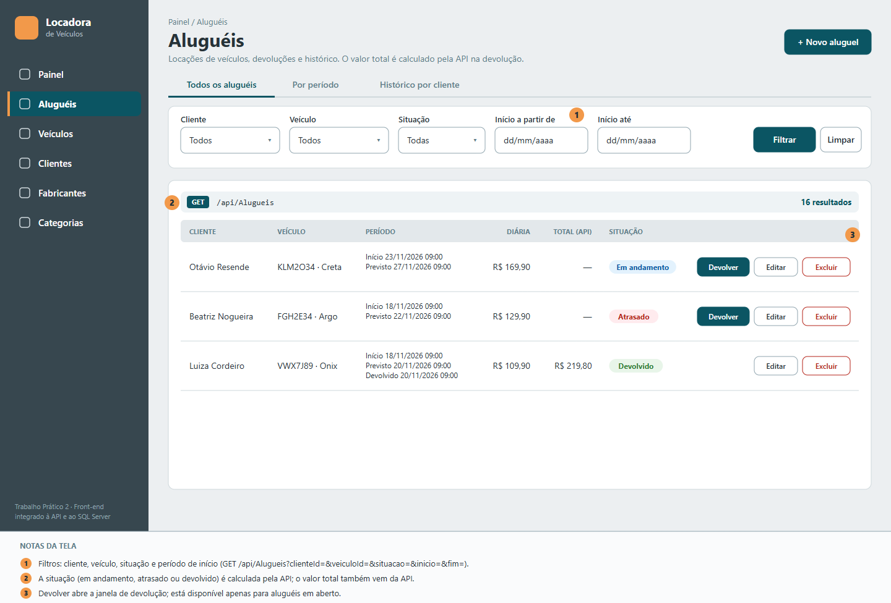
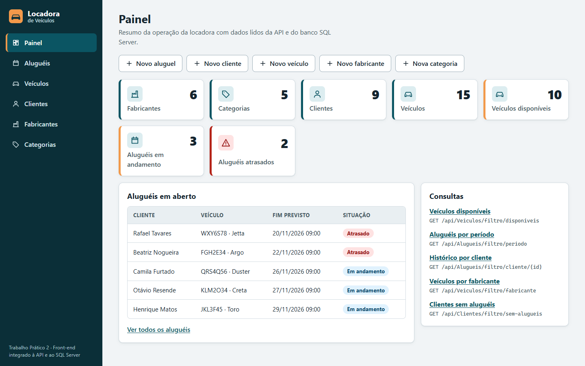
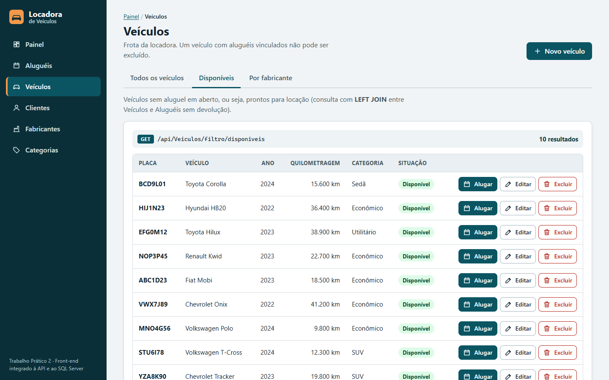
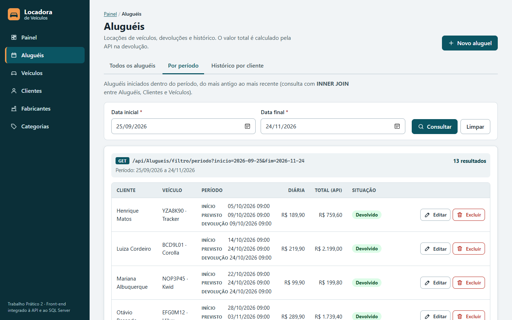
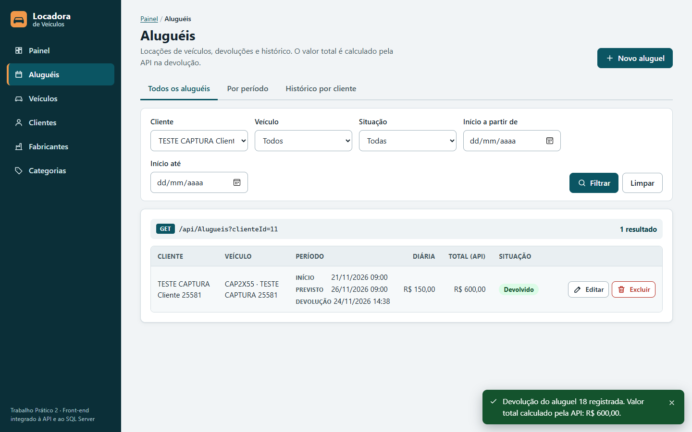

# Locadora de Veículos — Trabalho Prático (Etapas 1 e 2)

Sistema de gestão de uma locadora de veículos: **banco SQL Server** modelado com Entity Framework Core (Etapa 1), **API REST em
ASP.NET Core** (Etapa 1) e **frontend React + TypeScript** integrado à API real (Etapa 2).

> **Autor:** Caio Moraes da Silva — Pontifícia Universidade Católica de Minas Gerais — PUC Minas, Unidade Betim
> (disciplina: Tecnologias para Análise e Desenvolvimento de Sistemas) · 1556029@pucminas.edu.br
>
> **Status da Etapa 2:** frontend, integração, filtros, wireframes, testes, relatório (modelo da SBC) e roteiro do vídeo prontos.
> **Pendência única:** gravação e envio do vídeo de apresentação (3 a 5 minutos) — veja [docs/checklist-entrega.md](docs/checklist-entrega.md).

## Sumário

1. [Tecnologias](#tecnologias)
2. [Requisitos](#requisitos)
3. [Estrutura do repositório](#estrutura-do-repositório)
4. [Modelo de dados e migrations](#modelo-de-dados-e-migrations)
5. [Como executar](#como-executar)
6. [Variáveis de ambiente](#variáveis-de-ambiente)
7. [Telas e rotas do frontend](#telas-e-rotas-do-frontend)
8. [Rotas da API usadas pelo frontend](#rotas-da-api-usadas-pelo-frontend)
9. [Wireframes e Figma](#wireframes-e-figma)
10. [Relatório acadêmico (modelo oficial da SBC)](#relatório-acadêmico-modelo-oficial-da-sbc)
11. [Testes e build](#testes-e-build)
12. [Capturas de tela](#capturas-de-tela)
13. [Autoria e entrega](#autoria-e-entrega)

## Tecnologias

| Camada | Tecnologias |
| --- | --- |
| Banco de dados | SQL Server (Express ou outra edição), migrations do EF Core |
| Backend | ASP.NET Core (.NET 9), Entity Framework Core 9, controllers REST, Swagger |
| Frontend | React 19, TypeScript, Vite, React Router, CSS próprio (sem biblioteca visual), `fetch` |
| Testes | Vitest + Testing Library (telas e serviços), Playwright + axe-core (ponta a ponta com API e SQL Server reais) |

Não há dados estáticos ou simulados na aplicação: todas as telas leem e gravam na API, que persiste no SQL Server. *Mocks existem
apenas nos testes automatizados do Vitest.*

## Requisitos

- .NET SDK 9 (ou superior; o projeto tem como alvo `net9.0`)
- SQL Server acessível (por padrão a instância `.\SQLEXPRESS`)
- Node.js 20.19+ ou 22.12+ (testado com Node 24) e npm
- Para os testes ponta a ponta: um navegador (Edge/Chrome instalados ou o Chromium do Playwright)

## Estrutura do repositório

```text
LocadoraVeiculos-main/
├── Controllers/  Models/  Dtos/  Data/  Migrations/   Backend ASP.NET Core (Etapa 1 + extensões da Etapa 2)
├── Program.cs  appsettings.json  LocadoraVeiculosApi.csproj
├── frontend/                                           Aplicação React
│   ├── src/
│   │   ├── components/   componentes reutilizáveis (layout, tabela, formulários, diálogos, avisos)
│   │   ├── pages/        dashboard, fabricantes, categorias, clientes, veiculos, alugueis
│   │   ├── services/     acesso centralizado à API (http.ts + um módulo por entidade)
│   │   ├── hooks/  types/  utils/  styles/  test/
│   ├── e2e/              testes ponta a ponta e geração das capturas
│   ├── scripts/          gerador dos wireframes (SVG/PNG)
│   └── .env.example
└── docs/
    ├── documentacao-apis.md      documentação das rotas (Etapa 1 + extensões da Etapa 2)
    ├── modelo-conceitual.png     modelo conceitual (Etapa 1)
    ├── relatorio-testes.md/.pdf  evidências dos testes da API (Etapa 1)
    ├── wireframes/               20 wireframes em PNG e SVG (docs/wireframes/svg, prontos para importar no Figma)
    ├── evidencias/               capturas do Swagger (Etapa 1) e do frontend (docs/evidencias/frontend)
    ├── artigo/                   relatório no padrão SBC (.tex, .docx, .pdf, referências e imagens)
    ├── scripts/                  dados fictícios de demonstração e script de limpeza
    ├── roteiro-video.md          roteiro do pitch de 3 a 5 minutos
    └── checklist-entrega.md      checklist final
```

## Modelo de dados e migrations

Entidades: `Fabricante`, `Categoria`, `Cliente`, `Veiculo` e `Aluguel`.

- Um fabricante e uma categoria possuem vários veículos (`ON DELETE RESTRICT`).
- Um cliente e um veículo possuem vários aluguéis (`ON DELETE RESTRICT`).
- Índices únicos: nome do fabricante, nome da categoria, CPF e e-mail do cliente, placa do veículo.
- Restrições `CHECK` para ano/quilometragem do veículo e para datas, quilometragens e valores do aluguel.

O modelo conceitual está em [docs/modelo-conceitual.png](docs/modelo-conceitual.png). A migration inicial (`InitialCreate`) está em
`Migrations/` e a Etapa 2 **não alterou o esquema do banco**: a disponibilidade do veículo e a situação do aluguel são calculadas
em consulta, não persistidas.

## Como executar

### 1. Banco de dados e migrations

A cadeia de conexão padrão (`appsettings.json`) aponta para `.\SQLEXPRESS`, banco `LocadoraVeiculosDb`:

```powershell
dotnet restore
dotnet tool restore
dotnet ef database update
```

O `dotnet-ef` é restaurado como ferramenta local do projeto (`dotnet-tools.json`).

Para usar outra instância, **sem editar arquivos versionados**, defina a variável de ambiente antes de migrar e de executar a API:

```powershell
$env:ConnectionStrings__DefaultConnection = "Server=localhost;Database=LocadoraVeiculosDb;Trusted_Connection=True;TrustServerCertificate=True;"
```

*Dados fictícios opcionais* para demonstração (fabricantes, categorias, clientes, veículos e aluguéis com datas relativas a hoje):

```powershell
sqlcmd -S .\SQLEXPRESS -E -C -d LocadoraVeiculosDb -f 65001 -i docs\scripts\dados-demonstracao.sql
# para remover depois:
sqlcmd -S .\SQLEXPRESS -E -C -d LocadoraVeiculosDb -f 65001 -i docs\scripts\limpar-demonstracao.sql
```

### 2. Backend (API)

```powershell
dotnet run
```

- API: `http://localhost:5000` · Swagger: `http://localhost:5000/swagger`
- Se a máquina tiver apenas o runtime do .NET 10 (sem o 9), execute com `$env:DOTNET_ROLL_FORWARD = "LatestMajor"`.

### 3. Frontend

```powershell
cd frontend
npm install
npm run dev
```

Abra `http://localhost:5173`. O Vite encaminha `/api` para `http://localhost:5000` (proxy), então não há problema de CORS em desenvolvimento.

Para a versão de produção: `npm run build` (gera `frontend/dist`) e `npm run preview` (porta 4173, também com o proxy de `/api`).

## Variáveis de ambiente

| Onde | Variável | Padrão | Uso |
| --- | --- | --- | --- |
| Frontend (`frontend/.env`) | `VITE_API_URL` | vazio | URL base da API. Vazio = usa o proxy do Vite em `/api`. Se definida (ex.: `http://localhost:5000`), as chamadas vão direto à API e exigem CORS. |
| Frontend | `VITE_API_PROXY_TARGET` | `http://localhost:5000` | Destino do proxy do Vite (`dev` e `preview`). |
| Backend | `ConnectionStrings__DefaultConnection` | `.\SQLEXPRESS` (appsettings) | Cadeia de conexão com o SQL Server. |
| Backend | `Cors:AllowedOrigins` (ou `Cors__AllowedOrigins__0`) | `localhost`/`127.0.0.1` nas portas `5173` e `4173` | Únicas origens de navegador aceitas pela API; não há origem curinga. |
| Testes E2E | `PW_CHANNEL` | vazio (Chromium do Playwright) | `msedge` ou `chrome` para usar um navegador já instalado. |

Copie `frontend/.env.example` para `frontend/.env` se precisar alterar os valores.

## Telas e rotas do frontend

| Rota | Tela |
| --- | --- |
| `/` | Painel com indicadores reais (fabricantes, categorias, clientes, veículos, disponíveis, aluguéis em andamento e atrasados), atalhos e aluguéis em aberto |
| `/fabricantes`, `/fabricantes/novo`, `/fabricantes/:id/editar` | Listagem com filtros (código e nome), cadastro e edição |
| `/categorias`, `/categorias/nova`, `/categorias/:id/editar` | Idem para categorias |
| `/clientes`, `/clientes/novo`, `/clientes/:id/editar` | Filtros por nome, CPF e e-mail; aba **Sem aluguéis** |
| `/veiculos`, `/veiculos/novo`, `/veiculos/:id/editar` | Filtros (placa, modelo, fabricante, categoria, disponibilidade); abas **Disponíveis** e **Por fabricante** |
| `/alugueis`, `/alugueis/novo`, `/alugueis/:id/editar` | Filtros (cliente, veículo, situação, período); abas **Por período** e **Histórico por cliente**; registro de devolução |

Todas as listagens possuem exclusão com confirmação, mensagens de sucesso e erro, carregamento, estado vazio e validação de formulário.
O tipo de consulta e os filtros ficam na URL (`?consulta=disponiveis`, `?nome=...`), então recarregar a página preserva a mesma consulta.

## Rotas da API usadas pelo frontend

| Entidade | CRUD | Consultas |
| --- | --- | --- |
| Fabricantes | `GET/POST /api/Fabricantes`, `GET/PUT/DELETE /api/Fabricantes/{id}` | `GET /api/Fabricantes?id=&nome=` |
| Categorias | `GET/POST /api/Categorias`, `GET/PUT/DELETE /api/Categorias/{id}` | `GET /api/Categorias?id=&nome=` |
| Clientes | `GET/POST /api/Clientes`, `GET/PUT/DELETE /api/Clientes/{id}` | `GET /api/Clientes?nome=&cpf=&email=`, `GET /api/Clientes/filtro/sem-alugueis` |
| Veículos | `GET/POST /api/Veiculos`, `GET/PUT/DELETE /api/Veiculos/{id}` | `GET /api/Veiculos?placa=&modelo=&fabricanteId=&categoriaId=&disponivel=`, `GET /api/Veiculos/filtro/disponiveis`, `GET /api/Veiculos/filtro/fabricante?nome=` |
| Aluguéis | `GET/POST /api/Alugueis`, `GET/PUT/DELETE /api/Alugueis/{id}` | `GET /api/Alugueis?clienteId=&veiculoId=&situacao=&inicio=&fim=`, `GET /api/Alugueis/filtro/periodo?inicio=&fim=`, `GET /api/Alugueis/filtro/cliente/{clienteId}` |

### Alterações mínimas feitas no backend

1. **CORS restrito** às origens de `Cors:AllowedOrigins` (também aplicado às respostas de erro 409/500).
2. **Filtros opcionais por query string** nos `GET` de listagem (sem parâmetros o comportamento é o da Etapa 1).
3. Campos derivados nas respostas: `disponivel` (veículo) e `situacao` (aluguel: `EmAndamento`, `Atrasado`, `Devolvido`). Os corpos de `POST`/`PUT` não mudaram.
4. `LocadoraVeiculosApi.csproj` ignora a pasta `frontend/` na compilação; `dotnet-tools.json` registra o `dotnet-ef` como ferramenta local.

Detalhes em [docs/documentacao-apis.md](docs/documentacao-apis.md#extensões-da-etapa-2-integração-com-o-frontend). O valor total do aluguel
continua sendo calculado **somente pela API**; o frontend exibe apenas uma *estimativa* identificada como tal na devolução.

## Wireframes e Figma

Os 20 wireframes de alta fidelidade (desktop 1440 px) cobrem layout/navegação, painel, as cinco entidades (lista e formulário), as consultas,
a devolução, a confirmação de exclusão e os estados de carregamento, vazio e erro. Estão disponíveis:

- **no Figma:** <https://www.figma.com/design/h5DPiA2ZDKuXXmZ4pPTxMg/Untitled?node-id=1-3&t=qwLSrYq5Za5AQfFy-1>
- **em PNG:** [docs/wireframes](docs/wireframes)
- **em SVG editável:** [docs/wireframes/svg](docs/wireframes/svg)

Os PNG e SVG são gerados por `npm run wireframes` (em `frontend/`), a partir de uma descrição única de layout.



## Relatório acadêmico (modelo oficial da SBC)

O relatório está em [docs/artigo](docs/artigo): `artigo.tex` (formatado com o modelo SBC, usando `sbc-template.sty` e `sbc.bst` desta pasta),
`referencias.bib`, `imagens/`, `artigo.pdf` e `artigo.docx` (detalhes em [docs/artigo/LEIA-ME.md](docs/artigo/LEIA-ME.md)). O texto vem de uma fonte única (`conteudo.py`), que `gerar_artigo.py` converte em `.tex`, `.bib` e `.docx`.

```powershell
cd docs\artigo
python gerar_artigo.py                                  # regenera artigo.tex, referencias.bib e artigo.docx
pdflatex artigo; bibtex artigo; pdflatex artigo; pdflatex artigo   # gera artigo.pdf
```

## Testes e build

Backend:

```powershell
dotnet build              # 0 avisos, 0 erros
dotnet run                # API em http://localhost:5000 (para os testes ponta a ponta)
```

Frontend (`cd frontend`):

```powershell
npm run typecheck         # tsc --noEmit
npm run lint              # eslint
npm test                  # Vitest: 82 testes em 7 arquivos
npm run build             # tsc + build de produção (vite)
npx playwright install chromium   # apenas se não usar Edge/Chrome instalados
npm run test:e2e          # Playwright: 8 testes ponta a ponta (exige API + SQL Server em execução)
```

Os testes ponta a ponta criam registros com o prefixo `TESTE E2E`, exercitam CRUD, filtros, consultas especiais, devolução, conflitos 409,
recarregamento em rotas internas, API indisponível e uma varredura de acessibilidade (axe-core, WCAG A/AA) e **removem tudo ao final**.
Resultados da última execução: veja [docs/checklist-entrega.md](docs/checklist-entrega.md) e a seção *Testes e resultados* do relatório ([docs/artigo/artigo.pdf](docs/artigo/artigo.pdf)).

## Capturas de tela

As imagens de [docs/evidencias/frontend](docs/evidencias/frontend) foram geradas pelo sistema em funcionamento (`npm run capturas`).

| Painel | Veículos disponíveis (consulta 1) |
| --- | --- |
|  |  |

| Aluguéis por período (consulta 2) | Registro de devolução |
| --- | --- |
|  |  |

## Autoria e entrega

- Autor: **Caio Moraes da Silva** · Instituição: **Pontifícia Universidade Católica de Minas Gerais — PUC Minas, Unidade Betim** ·
  Disciplina: **Tecnologias para Análise e Desenvolvimento de Sistemas** · E-mail acadêmico: 1556029@pucminas.edu.br
- Repositório GitHub: <https://github.com/CaioM0RAES762/LocadoraVeiculos.git> (branch `main`, histórico de commits pequenos e progressivos).
- Wireframes no Figma: <https://www.figma.com/design/h5DPiA2ZDKuXXmZ4pPTxMg/Untitled?node-id=1-3&t=qwLSrYq5Za5AQfFy-1>
- Entrega: relatório (`docs/artigo/artigo.pdf`), repositório compactado (.zip) e vídeo de 3 a 5 minutos (roteiro em
  [docs/roteiro-video.md](docs/roteiro-video.md)). Confira tudo em [docs/checklist-entrega.md](docs/checklist-entrega.md).
